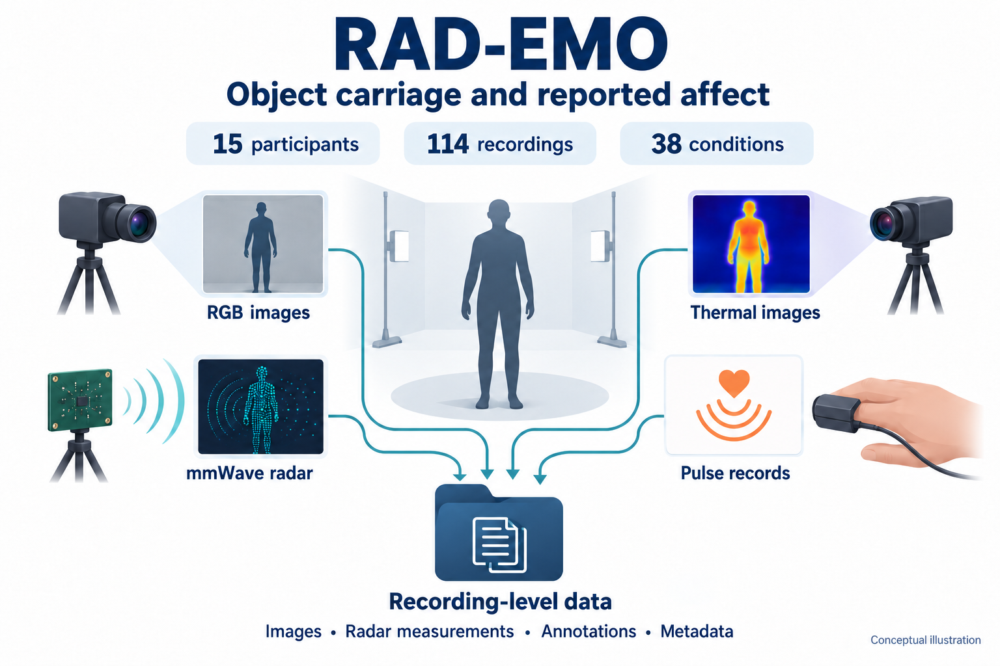
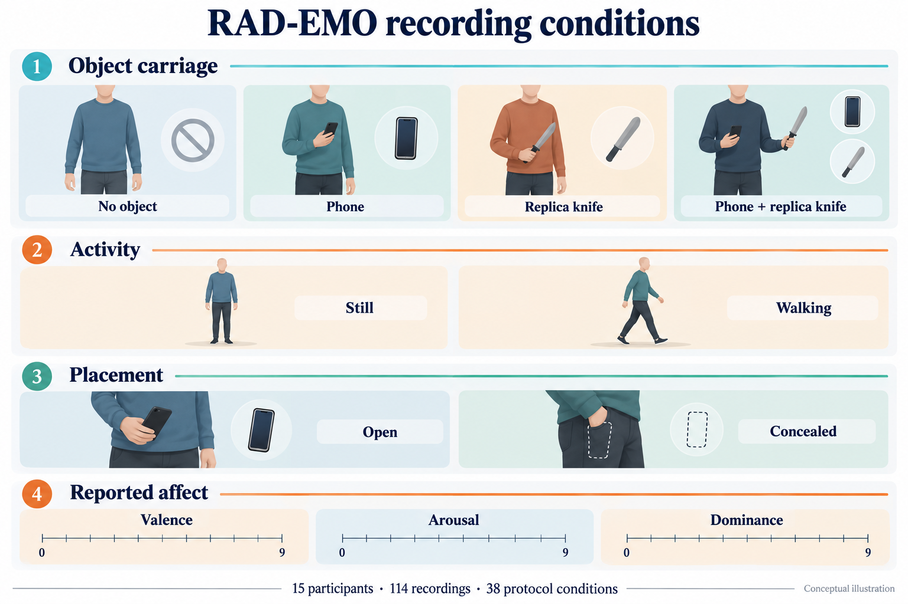
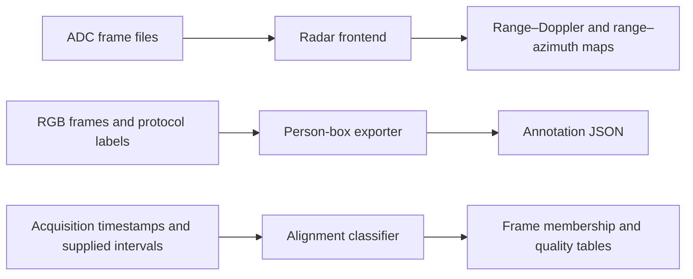

<div align="center">

# RAD-EMO

### Object carriage and reported affect through multimodal sensing

**15 participants · 114 recordings · 38 conditions · RGB, thermal, radar and pulse**

[Study design](#study-design) · [Conditions](#recording-conditions) · [Inside a recording](#inside-a-recording) · [File organisation](#file-organisation) · [Processing code](#processing-the-data)

**[Request the dataset](mailto:ogonna.okafor@ntu.ac.uk?subject=RAD-EMO%20dataset%20request)**

</div>



RAD-EMO brings together observations of **what a person is doing and carrying**
with **how they report feeling** during a laboratory task. RGB images, thermal
images, radar ADC frames and pulse acquisition records describe the same
recording from different perspectives. A common set of recording identifiers
connects those observations to the collection protocol and affect ratings.

The collection supports research on object carriage, affect estimation,
contactless sensing and multimodal analysis. Its repeated protocol provides
examples of similar conditions performed by different participants, while
retaining each sensor's own observations and timing.

## Study design

The collection contains **15 participants**, identified as P1–P15, and **114
recordings** acquired in one indoor laboratory setting, ISTEC 031C. The study
protocol was designed for adult volunteers aged 18 and over.

Participants were organised into three groups of five. Each group collectively
completed the same 38-condition schedule, so each condition appears three times
in the collection. The first four people in each group completed seven
recordings each; the fifth completed ten.

| Participant group | Allocation within the group | Recordings |
| :--- | :--- | ---: |
| P1–P5 | P1–P4: seven each; P5: ten | 38 |
| P6–P10 | P6–P9: seven each; P10: ten | 38 |
| P11–P15 | P11–P14: seven each; P15: ten | 38 |
| **Total** | **15 participants** | **114** |

During the task, participants remained stationary or walked while following an
assigned carrying and affect condition. The resulting collection contains
**60 stationary recordings and 54 walking recordings**. Camera sequences can
include time around the active task; the alignment tables identify the relevant
recording intervals for multimodal analysis.

## Recording conditions

The protocol combines four carrying scenarios with activity, visibility and
prompted affect. The phone and knife scenarios include open and concealed
carriage. The conditions without either target object also include everyday
distractors such as keys, a tool, a tablet or a mug.



| Carrying scenario | Protocol code | Conditions | Recordings |
| :--- | :---: | ---: | ---: |
| Phone | PWP | 10 | 30 |
| Knife | PWK | 10 | 30 |
| Phone and knife | PWPK | 12 | 36 |
| Neither target object, including distractor conditions | PO | 6 | 18 |
| **Total** | | **38** | **114** |

The condition schedule specifies the intended activity and carrying state.
Detailed carrying-zone and concealment-material codes describe the planned
protocol; they were not enforced as controlled factors during acquisition.

### Prompted affect and participants' reports

Five prompt categories cover neutral affect and the four valence/arousal
quadrants:

| Code | Prompted condition |
| :---: | :--- |
| E0 | Neutral |
| E1 | Positive valence, high arousal |
| E2 | Negative valence, high arousal |
| E3 | Negative valence, low arousal |
| E4 | Positive valence, low arousal |

Participants' **valence, arousal and dominance** ratings are stored separately
on **0–9 scales**. The protocol asks for ratings after emotion blocks, and the
self-report table links the recorded ratings to session IDs. This lets readers
work with the prompted condition, the reported experience or both.

For analyses using low valence and high arousal, the supplied LVHA label follows
`valence <= 4 and arousal >= 6`. The four categorical joint states combine LVHA
with protocol-assigned knife carriage:

| State | Knife carriage | Reported LVHA |
| :---: | :---: | :---: |
| T1 | No | No |
| T2 | No | Yes |
| T3 | Yes | No |
| T4 | Yes | Yes |

The stored `protocol_risk_index` field uses `1 + LVHA + 2 * knife_present_protocol`.
It maps to the four categorical states above. The condition schedule and
self-reports remain the underlying labels.

<details>
<summary><strong>Explore the complete 38-condition schedule</strong></summary>

Each row below is represented once in each participant group. The same schedule
is available as [a CSV table](protocol/conditions.csv).

| Condition | Carried objects | Visibility | Activity | Affect prompt |
| :---: | :--- | :---: | :--- | :---: |
| C01 | Phone | Open | Stationary | E0 |
| C02 | Phone | Open | Walking | E1 |
| C03 | Phone | Open | Stationary | E2 |
| C04 | Phone | Open | Walking | E3 |
| C05 | Phone | Concealed | Stationary | E0 |
| C06 | Phone | Concealed | Walking | E2 |
| C07 | Phone | Concealed | Stationary | E2 |
| C08 | Phone | Concealed | Walking | E3 |
| C09 | Phone | Concealed | Stationary | E4 |
| C10 | Phone | Concealed | Walking | E3 |
| C11 | Knife | Open | Stationary | E0 |
| C12 | Knife | Open | Walking | E1 |
| C13 | Knife | Open | Stationary | E2 |
| C14 | Knife | Open | Walking | E2 |
| C15 | Knife | Open | Stationary | E0 |
| C16 | Knife | Open | Walking | E4 |
| C17 | Knife | Concealed | Stationary | E0 |
| C18 | Knife | Concealed | Walking | E1 |
| C19 | Knife | Concealed | Stationary | E2 |
| C20 | Knife | Concealed | Walking | E3 |
| C21 | Phone + knife | Open | Stationary | E0 |
| C22 | Phone + knife | Open | Walking | E1 |
| C23 | Phone + knife | Open | Stationary | E2 |
| C24 | Phone + knife | Open | Walking | E3 |
| C25 | Phone + knife | Concealed | Stationary | E0 |
| C26 | Phone + knife | Concealed | Walking | E4 |
| C27 | Phone + knife | Concealed | Stationary | E2 |
| C28 | Phone + knife | Concealed | Walking | E3 |
| C29 | Phone + knife | Concealed | Stationary | E0 |
| C30 | Phone + knife | Concealed | Walking | E4 |
| C31 | Phone + knife | Concealed | Stationary | E2 |
| C32 | Phone + knife | Concealed | Walking | E3 |
| C33 | Neither target | — | Stationary | E0 |
| C34 | Neither target | — | Walking | E1 |
| C35 | Neither target (keys/tool) | — | Stationary | E2 |
| C36 | Neither target (keys/tool) | — | Stationary | E3 |
| C37 | Neither target (tablet/mug) | — | Walking | E4 |
| C38 | Neither target (tablet/mug) | — | Stationary | E4 |

</details>

## Inside a recording

**RGB and thermal images** provide complementary views of the participant and
the task. RGB sequences contain **189,835 PNG images at 640 × 480 pixels** across
all 114 recordings. The thermal component contains **65,367 rendered PNG images**
across the same recording catalogue. The delivered thermal images are
false-colour visualisations; their pixel values are not Celsius measurements.

**Radar observations** are supplied as individual
`adcData_frame_####.mat` files. The current frame-export inventory contains
**30,817 frames from 76 recordings and 10 participants**. Each MATLAB v7.3 file
contains a complex `adcData` array representing the radar samples for one frame.
The acquisition uses a **77 GHz TI cascade MIMO system with 12 transmitters and
16 receivers**.

| MATLAB array axis | Size | Meaning |
| :--- | ---: | :--- |
| ADC sample | 80 | Fast-time samples within a chirp |
| Loop | 25 | Slow-time repetitions |
| Receiver | 16 | Receive-channel storage order |
| Transmitter slot | 12 | Transmit/chirp-slot storage order |

MATLAB displays the array as `[80, 25, 16, 12]`. Python's HDF5 view exposes the
stored axes as `[12, 16, 25, 80]`; the included radar reader decodes the complex
values and makes this ordering explicit.

**Pulse readings and camera timing** accompany RGB acquisition rows in
`data.csv`. Its fields are `Frame No`, `Color Timestamp (ms)` and
`Pulse Sensor Value`. Thermal acquisition tables contain `Frame No` and
`Timestamp (ms)`. Pulse values retain the serial sensor readings associated with
the RGB rows; they are not supplied as calibrated heart-rate measurements.

**Person annotations** connect image filenames to person bounding boxes and the
recording's PO, PWP, PWK or PWPK class. The included exporter uses YOLOv8x person
detections. Each box describes the person in image coordinates, with
`x`, `y`, `width` and `height`; object carriage comes from the protocol label.
Detection outputs and annotation-review records should be read together when selecting a subset.

### How the streams line up

Frame timestamps and recording identifiers link the streams. RGB and thermal
retain their acquisition timestamps, while the radar alignment tables supply
frame timing and the method used to associate it with the camera observations.
Radar wall-clock alignment is reconstructed, with source and uncertainty fields,
so the supported association is approximate at recording and window level.

The saved RGB cadence varies: whole-recording rates are approximately
**29.82–36.09 images per second**, with a median of **33.50**. Processing should use
the supplied timestamps and frame identifiers. The data retain their original
sampling and gaps; the processing code keeps these distinctions when building
frame memberships.

## File organisation

Sensor folders are organised by participant and recording. This example uses
**P2S1**, for which RGB, thermal and radar ADC frame files are present.

```text
rgb+mmw_exp2/
└── P_2/
    └── P_2_S_1/
        ├── color_frames/
        │   ├── color_frame_0.png
        │   └── ...
        ├── data.csv
        ├── 2D-on-2D_annotations_export.json
        └── Cascade_Capture_p2_s1/
            ├── adcData_frame_0001.mat
            ├── adcData_frame_0002.mat
            └── ...

thermal_data_exp2/
└── P_2/
    └── P_2_S_1/
        ├── thermal_frames/
        │   ├── thermal_frame_0.png
        │   └── ...
        └── data.csv

RAD_EMO_DATASET_v1.0.0/
├── metadata/
│   ├── sessions.csv
│   ├── conditions.csv
│   ├── emotion_self_report.csv
│   └── derived_labels.csv
└── synchronization/
    └── v2/
        ├── active_intervals.csv
        └── dataset_view_v2.json
```

`P_2_S_1`, `Cascade_Capture_p2_s1` and the table identifier `P2S1` refer to the
same recording. Original RGB files for P1's first three recordings are retained
under `realsense_data/P_1/`; the recording manifest selects one copy of each
frame when assembling a subset.

The metadata tables provide the joins needed to interpret the folders:

| Table | What readers use it for |
| :--- | :--- |
| `sessions.csv` | Join recording, participant, condition and acquisition context |
| `conditions.csv` | Interpret the 38 protocol conditions |
| `emotion_self_report.csv` | Retrieve recording-linked valence, arousal and dominance |
| `derived_labels.csv` | Apply the documented LVHA and joint-state rules |
| `active_intervals.csv` | Select task intervals with timing provenance and uncertainty |
| `dataset_view_v2.json` | Locate the corresponding versioned alignment tables |

## Processing the data

The repository includes the project's radar frontend, metadata builders and
person-box exporter, with portable entry points for use on the supplied files.
The radar modules and the original timing parser/classifier are retained; the
command-line wrappers make input paths and output directories explicit.

The workflows below start from an approved data bundle. They write results into
new output directories and preserve the supplied sensor files.



### Set up the Python tools

Use Python **3.10–3.12**. The Python routines were checked with Python 3.12.7;
the radar reference environment uses NumPy 1.26.4, h5py 3.11.0 and SciPy 1.13.1.

```sh
git clone https://github.com/Ogoskino/RAD-EMO.git
cd RAD-EMO
python -m pip install -r code/radar/requirements.txt
```

In these examples, `data/` contains the supplied modality folders and metadata
in the layout shown above. Keep local path configurations in `*.local.json`;
the repository ignores these files, downloaded data, model weights and outputs.

### Process radar ADC frames

The [recording processor](code/radar/process_adc_recording.py) runs the retained
frontend on the MAT files in one recording, in numeric frame order:

```sh
python code/radar/process_adc_recording.py --adc-dir data/rgb+mmw_exp2/P_2/P_2_S_1/Cascade_Capture_p2_s1 --output-dir outputs/radar/P2S1 --materialize
```

For a single frame, use:

```sh
python code/radar/process_adc_mat.py --adc-mat data/rgb+mmw_exp2/P_2/P_2_S_1/Cascade_Capture_p2_s1/adcData_frame_0001.mat --output-dir outputs/radar/frame_0001 --materialize
```

The default `as_saved` route reads the exported complex samples, applies the
project's receiver ordering and range/Doppler/angle processing, and retains the
export's upstream calibration state. FFT sizes are **128 / 32 / 256**. The
`--materialize` option makes a temporary local copy of the selected input frame,
which supports files downloaded through OneDrive.

Each processed frame produces:

- `representations.npz`: range–Doppler maps `[doppler=32, range=104]`,
  range–azimuth and dynamic/static maps `[azimuth=256, range=104]`,
  physical axes and support flags.
- `processing.json`: input checksum, array axes and units, processing settings
  and output checksum.

The recording command creates one output subfolder per frame and a
`recording_processing.json` index. Add `--include-rad` to retain the
RAD power array `[azimuth=256, doppler=32, range=104]` as well. The retained range
bins are 5–108 inclusive; their physical coordinates are saved with the arrays.

<details>
<summary><strong>Acquisition-stage ADC export with MATLAB</strong></summary>

The [MATLAB adapter](code/radar/matlab/export_adc_frames.m) follows the
project's `get_adcData.m` export workflow. It requires the installed TI
mmWave Studio 02.01.01.00 four-chip MATLAB example chain, the corresponding
capture configuration, module parameters and calibration MAT file.

After setting the four input variables to their local paths:

```matlab
addpath('code/radar/matlab');
export_adc_frames(tiChainRoot, captureFolder, calibrationMat, moduleParamFile, 'outputs/adc_export');
```

It writes one `adcData_frame_####.mat` per valid frame, with variable `adcData`
in MATLAB v7.3 format, and records chunk/frame correspondence in
`frame_sources.csv`. Numbering continues across chunks. The supplied radar MAT
files can be read directly by the Python tools above.

</details>

### Reproduce the person-box annotations

The [annotation exporter](code/images/yolov8_export_2d_annotations.py) uses the
same class definitions, person selection and JSON format as the project's
existing exporter. Install its additional dependencies, then provide the RGB
root and canonical session table:

```sh
python -m pip install -r code/images/requirements.txt
python code/images/yolov8_export_2d_annotations.py --root data/rgb+mmw_exp2 --output-root outputs/person_annotations --sessions-csv data/RAD_EMO_DATASET_v1.0.0/metadata/sessions.csv --model yolov8x.pt --conf 0.25 --imgsz 640 --select largest --include-empty
```

The command keeps the largest eligible person detection and writes
`P_N/P_N_S_M/2D-on-2D_annotations_export.json` beneath the output root.
Images with no selected person keep an empty annotation list. A custom
`--label-map` can instead supply a CSV with `session,label` columns. Use
`--model` to select the intended weight file and record the installed
Ultralytics version when reproducing annotation runs.

The command processes only the selected RGB root. To process P1's separately
retained originals, repeat it with `--root data/realsense_data/P_1` and
`--output-root outputs/person_annotations_p1_originals`. Keep one annotation
set for each selected recording and image copy when assembling a subset.

### Rebuild labels and check recording coverage

The [metadata builder](code/metadata/build_metadata_v1.py) reads the approved
protocol DOCX and self-report XLSX. It checks their reference hashes and rebuilds
`conditions.csv`, `sessions.csv`, `emotion_self_report.csv` and
`derived_labels.csv`. This step uses the original source documents; readers
using an existing supplied metadata bundle can start with those CSV tables.

```sh
python code/metadata/build_metadata_v1.py --protocol-docx "data/source_documents/data_collection_RAD_EMO (1).docx" --emotion-xlsx data/source_documents/emotion_labels.xlsx --output-dir outputs/metadata
```

For the complete canonical collection, the [inventory tool](code/metadata/audit_dataset_v1.py)
counts frame filenames and checks small acquisition records. It expects a
single RGB/mmWave root. If the bundle retains P1S1–P1S3 originals separately,
use a separate working copy of the collection that includes the selected
images in their canonical `P_1/P_1_S_N/color_frames` folders. Keep one file per
recording/frame ID; the tool does not merge separate RGB roots. Copy
[the example path configuration](code/metadata/config/paths.example.json) to
`data/paths.local.json` and set the RGB root to that complete working copy,
along with the thermal and timestamp roots, then run:

```sh
python code/metadata/audit_dataset_v1.py --config data/paths.local.json --sessions-csv data/RAD_EMO_DATASET_v1.0.0/metadata/sessions.csv --output-dir outputs/inventory
```

Its output is `session_inventory.csv`. The metadata and inventory tools use
the Python standard library.

### Associate image frames with supplied task intervals

The [alignment tool](code/metadata/align_frames.py) reuses the original timestamp
parser and interval-classification rules. It accepts the supplied interval
bounds, reconstruction source and uncertainty, and works with selected
recordings or windows.

Create `data/streams.csv` from
[the stream-index template](code/metadata/config/streams.example.csv). For the
P2S1 example, paths are relative to that CSV:

```csv
session_id,modality,acquisition_csv,frames_dir
P2S1,rgb,rgb+mmw_exp2/P_2/P_2_S_1/data.csv,rgb+mmw_exp2/P_2/P_2_S_1/color_frames
P2S1,thermal,thermal_data_exp2/P_2/P_2_S_1/data.csv,thermal_data_exp2/P_2/P_2_S_1/thermal_frames
```

```sh
python code/metadata/align_frames.py --intervals data/RAD_EMO_DATASET_v1.0.0/synchronization/v2/active_intervals.csv --streams data/streams.csv --sessions data/RAD_EMO_DATASET_v1.0.0/metadata/sessions.csv --output-dir outputs/alignment
```

The outputs are `frame_membership.csv`, `frame_summary.csv`,
`timestamp_issues.csv` and `build_manifest.json`. They preserve the supplied
clock provenance and distinguish active frames, uncertain boundary frames,
outside-task frames and unusable timing. The tool classifies the supplied
timestamps; it does not estimate a replacement sensor clock.

### Check the processing code

The bundled tests cover complex MAT decoding and frontend parity, recording
ordering, annotation selection and box coordinates, metadata joins and
uncertainty-aware frame membership. They use fixtures and mock detections.

```sh
python -m unittest discover -s code/radar -p "test_*.py"
python -m unittest discover -s code/images -p "test_*.py"
python -m unittest discover -s code/metadata/tests -p "test_*.py"
```


## Working with the collection

For participant-independent evaluation, keep all recordings and windows from one
participant in the same partition. This preserves the intended distinction
between recognising patterns within familiar participants and generalising to
new people.

Modality coverage is recorded separately: an RGB recording can exist without a
corresponding radar MAT export. Use the recording and availability tables to
select the inputs required for an analysis, and retain the timing and annotation
review fields when constructing a subset.

## Access and citation

The dataset is **available upon reasonable request for research purposes**.
[Email Ogonna Okafor](mailto:ogonna.okafor@ntu.ac.uk?subject=RAD-EMO%20dataset%20request)
with your affiliation, intended research use and the recordings or modalities
required. Requests are reviewed under the study's participant consent and data
management arrangements. Approved files are supplied through institutional
OneDrive.

Study documents record a favourable opinion from Nottingham Trent University's
Human Invasive Ethics Committee, reference **2358867**.

**Dataset creator and contact:** Ogonna Okafor, Nottingham Trent University.

**Contributors:** Maria Mwanje (data collection) and David Adama (supervision),
Nottingham Trent University.

RAD-EMO will be introduced in the joint paper **Joint Recognition of Knife
Carriage and Reported Affect from Radar and Video**, by Ogonna Okafor, Maria
Drolence Mwanje and David Ada Adama. This paper is the intended reference for
the dataset. Its public link and final publication details will be added here
when available.

When reporting results, also identify the supplied data version or subset and
the processing settings used.

```bibtex
@unpublished{okafor_joint_carriage_affect,
  author = {Okafor, Ogonna and Mwanje, Maria Drolence and Adama, David Ada},
  title  = {Joint Recognition of Knife Carriage and Reported Affect from Radar and Video},
  year   = {2026},
  note   = {Manuscript}
}
```
